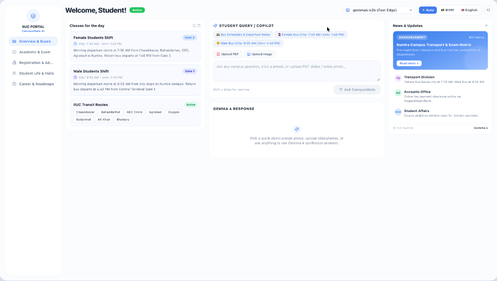
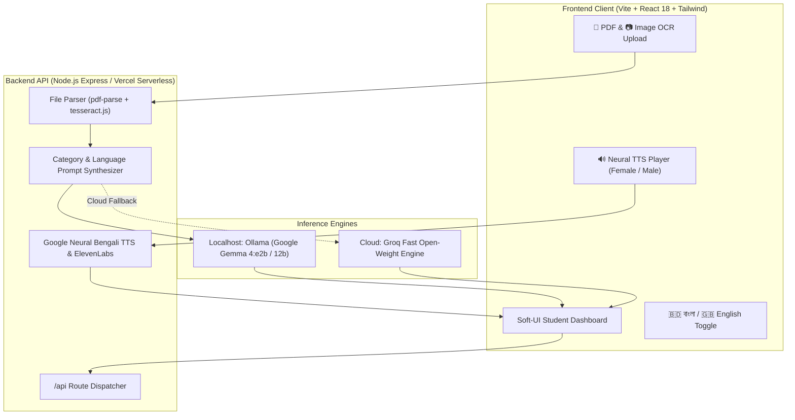

# CampusMate AI 🎓
> An intelligent, on-device campus life & academic copilot for IIUC students powered by Google Gemma 4.

[](https://opensource.org/licenses/MIT)
[](https://ai.google.dev/gemma)
[](https://ollama.com)
[](https://vercel.com)
[](https://hacktoberfest.com)

---

## 📸 Dashboard Preview



---

## 📌 The Problem
Students commuting to the **International Islamic University Chittagong (IIUC)** campus in Kumira, Sitakunda face recurring friction every semester:
1. **Scattered Transit Schedules:** University buses run between Chittagong city and the Kumira campus across 8 major transit routes (Chawkbazar, GEC, Bahaddarhat, Agrabad, Oxygen, Badamtoli, AK Khan, Bhatiary). However, departure shifts and gate numbers are scattered across Facebook posts, causing missed buses and daily confusion.
2. **Study & Exam Prep Fatigue:** Lecture slides and handwritten notes (especially in CSE, Pharmacy, BBA, EEE, and Islamic Studies) are hard to condense before semester finals. Students lack an instant tool to turn slides into concise summaries, clear Bangla explanations, and practice quiz questions.
3. **Complex Administrative Clearance:** Navigating online tuition payments via Nagad/bKash/Bank, pre-registration clearance for admit cards, and Student Affairs Division (SAD) protocols often wastes hours.
4. **Language Barrier:** Many campus tools only offer rigid English interfaces. Students need an AI copilot that fluently explains complex academic concepts in natural Bengali while maintaining technical accuracy.

---

## 💡 The Solution
**CampusMate AI** is a modern, student-centric web copilot built specifically for IIUC campus life. Designed with a clean Soft-UI aesthetic, it delivers instant answers across 5 campus pillars:

* 🚌 **IIUC Bus & Transit Routines:**
  * **Female Shift:** Departs city at **7:30 AM** | Return departure from Kumira campus at **1:40 PM** (Dedicated Gate 2 zone).
  * **Male Shift:** Departs city at **9:05 AM** | Return departure from Kumira campus at **4:40 PM** (Central Terminal Gate 1).
  * Full coverage of all 8 transit feeder routes with boarding tips.
* 📚 **Lecture-to-Quiz & Bangla Explainer:**
  * Ingests lecture slide PDFs or photos of handwritten notes.
  * Synthesizes 3-part study aids: (1) Core Executive Summary, (2) Simple & Lucid Bangla Explanation, and (3) 3 Practice MCQ Exam Questions with answers.
* 🏛️ **Admin, Fee & Clearance Guide:**
  * Step-by-step guidance on pre-registration, fee payment gateway clearance, and library clearance.
* 🌿 **Campus Life & Residential Halls:**
  * Guidance on Kumira residential halls, central cafeteria routines, and student clubs (Computer Club, Debating Club, Dawah Club).
* 🚀 **Department Career Roadmaps:**
  * Tailored skill guides and internship advice for IIUC academic departments.

---

## ✨ Key Features

| Feature | Description |
| :--- | :--- |
| **100% Bilingual Localization** | Seamlessly toggle between `🇧🇩 বাংলা` and `🇬🇧 English`. The entire UI (headings, preset cards, placeholders, news) adapts instantly. |
| **Strict Language Matching** | Ask in Bangla or type Bangla text, and get responses 100% in pure Bengali. Ask in English, and get responses in clear English. |
| **Studio Neural Bengali TTS** | Crystal-clear Bengali speech synthesis streaming direct MP3 audio, with both `👩 Female` and `👨 Male` voice options. |
| **Slide PDF & Photo Note OCR** | Direct file upload support for `.pdf` slides (`pdf-parse`) and handwritten notebook images (`tesseract.js`). |
| **No Cutoff / Full Answers** | Expanded generation capacity (up to 2,500 tokens) ensuring complete tables, study summaries, and all 3 quiz questions without truncation. |
| **Mobile-First Responsive UI** | Desktop sidebar gracefully tucks into an intuitive 3-dot (`⋮`) mobile dropdown menu for one-thumb navigation. |
| **Dual Inference Engine** | Runs **100% locally & offline** via Ollama on student laptops for privacy, with high-speed cloud open-weight fallback on Vercel. |

---

## 🏗️ Architecture



---

## 🚀 Getting Started

### Prerequisites
* **Node.js:** v18.0.0 or higher
* **npm:** v9.0.0 or higher
* *(Optional for local on-device inference)* [Ollama](https://ollama.com) installed with Google Gemma 4:
  ```bash
  ollama run gemma4:e2b
  ```

---

### Local Development Setup

#### 1. Clone the Repository
```bash
git clone https://github.com/Ridwanulkarim/CampusMateAI.git
cd CampusMateAI
```

#### 2. Install Dependencies
```bash
# Install root & backend dependencies
npm install
cd backend && npm install

# Install frontend dependencies
cd ../frontend && npm install
cd ..
```

#### 3. Configure Environment Variables
Create a `.env` file in the `backend/` directory (or use project root):
```env
PORT=5001
GROQ_API_KEY=your_groq_api_key_here
ELEVENLABS_API_KEY=your_optional_elevenlabs_key
OLLAMA_BASE_URL=http://127.0.0.1:11434
OLLAMA_MODEL=gemma4:e2b
```

#### 4. Run Locally
```bash
# Terminal 1: Launch Backend Server (Port 5001)
npm run server

# Terminal 2: Launch Frontend Client (Port 5173)
npm run client
```
Open [http://localhost:5173](http://localhost:5173) in your web browser.

---

## 🌐 Deploy to Vercel

CampusMate AI is fully pre-configured for **Vercel Serverless**:
1. Fork or push this repository to your GitHub account.
2. Go to [vercel.com](https://vercel.com) and click **"Add New..."** -> **"Project"**.
3. Select your repository `CampusMateAI` and click **"Import"**.
4. In the **Environment Variables** section, add:
   * `GROQ_API_KEY`: Your Groq Cloud API key
   * `ELEVENLABS_API_KEY`: *(Optional)* Your ElevenLabs key
5. Click **"Deploy"**. Your live production application will be online in under 2 minutes!

> **Note on Local vs. Deployed:** Deploying to Vercel does not affect your local setup. You can run locally during hackathon judging to demonstrate 100% offline on-device inference with Ollama, while using Vercel for public testing.

---

## ⚖️ Models and AI Disclosure (Hackathon Compliance)

* **Open-Weight Models Used:** Google Gemma 4 (`gemma4:e2b` and `gemma4:12b`) self-hosted locally via Ollama, with open-weight cloud acceleration on Groq.
* **AI Coding Assistant Disclosure:** Antigravity AI Assistant was utilized during the hackathon for UI scaffolding, component refactoring, and syntax verification.
* **Author Contributions:** Campus domain knowledge grounding, bilingual UI localization architecture, dual-engine failover design (Ollama + Groq), system prompt engineering for the 5 campus pillars, neural audio synthesis pipeline, and file OCR integrations were designed and implemented by **Ridwanul Karim**.

---

## 🗺️ Roadmap & Future Scope
- [x] Full bilingual localization (English & Bengali UI + AI output)
- [x] Studio Neural Bengali Speech Synthesis
- [x] Direct slide PDF and photo note OCR extraction
- [x] Mobile-responsive layout with 3-dot dropdown navigation
- [ ] Real-time IoT GPS tracking for university transit buses
- [ ] Telegram & WhatsApp bot endpoints for low-bandwidth student access
- [ ] Automated routine sync with the official IIUC Student Portal

---

## 👥 Credits & Acknowledgments
* [Google Gemma](https://ai.google.dev/gemma) for foundational open-weight language models.
* [Ollama](https://ollama.com) for on-device local LLM execution.
* [Major League Hacking (MLH)](https://mlh.io), [DEV](https://dev.to), **UniDevs**, and **Machine Learning Bangladesh** for organizing Hacktoberfest Hack Day Chittagong at IIUC.

---

## 📄 License
This project is open-source and licensed under the [MIT License](LICENSE).
